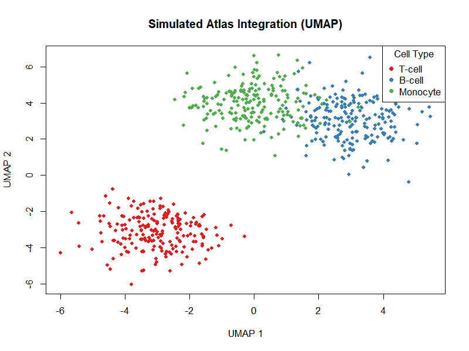

## Introduction

This is a test manuscript rendering pipeline.

## Results

We integrated synthetic single-cell datasets. The harmonized UMAP display is shown in @fig-umap, and cell counts per dataset are summarized in @tbl-counts.

```{r}
#| label: fig-umap
#| fig-cap: "Harmonized UMAP layout showing mock integrated cell types."
#| echo: false


```

```{r}
#| label: tbl-counts
#| tbl-cap: "Cell counts per dataset and cell type."
#| echo: false

counts <- read.csv("../output/tables/atlas_summary.csv")
knitr::kable(counts)
```